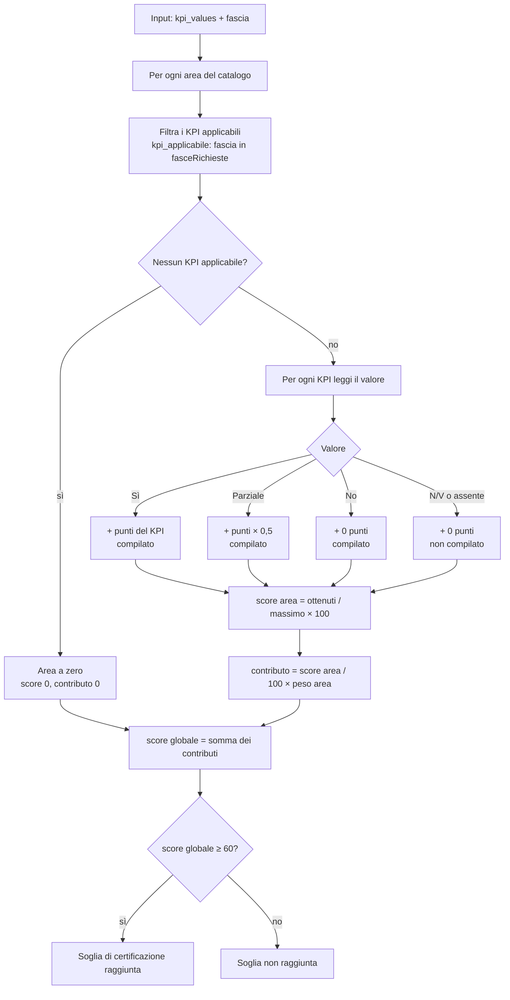
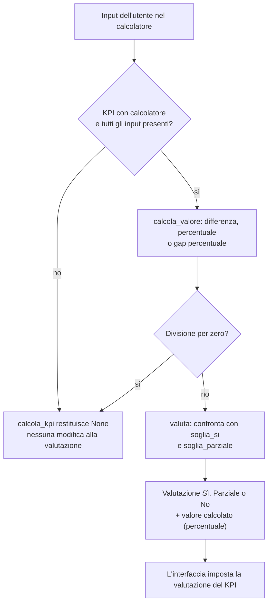
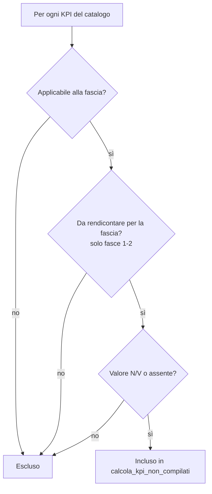

# Logica di calcolo: funzioni, input/output e flusso

Questo documento descrive la logica "pura" dello strumento (`src/data/`, `src/logic/`) e la sua
traduzione JavaScript (`frontend/static/js/`). Accompagna l'issue #21 (analisi e separazione
dei livelli) e l'issue #22 (equivalenza Python ↔ JavaScript).

## 1. Cosa significa "pura"

I moduli di `src/data/` e `src/logic/` **non** hanno:

- interfaccia (nessun import di Streamlit, Plotly, pandas);
- chiamate di rete o API esterne;
- accesso a database;
- lettura/scrittura di file (`open`, `os`, `pathlib`, …).

Ricevono dati in ingresso, restituiscono dati in uscita e non modificano mai i loro argomenti.
Questo è verificato automaticamente da `tests/test_purezza_logica.py`. L'unico codice che
legge o scrive su disco è in `scripts/` (esportazione del catalogo e delle fixture di test).

## 2. Funzioni critiche

Notazione: `kpi_values` = `{kpi_id: {"valore": "Sì"|"Parziale"|"No"|"N/V", "note": str, "percentuale": str}}`;
`fascia` = intero 1–4; `AREE`, `KPI_DA_RENDICONTARE_PER_FASCIA` e i parametri di scoring vengono dal catalogo.

### `src/logic/scoring.py`

| Funzione | Input | Output | Note |
|---|---|---|---|
| `kpi_applicabile(kpi, fascia)` | un KPI del catalogo, la fascia | `bool` | `True` se `fascia` ∈ `kpi["fasceRichieste"]` |
| `is_kpi_da_rendicontare(kpi_id, fascia)` | id del KPI, fascia | `bool` | `False` per le fasce fuori da `FASCE_CON_KPI_DA_RENDICONTARE` (3–4); altrimenti `True` se la fascia è nell'elenco del KPI in `KPI_DA_RENDICONTARE_PER_FASCIA` |
| `calcola_score_area(area, kpi_values, fascia)` | un'area, i valori, la fascia | `dict` con `score` (0–100), `massimo`, `ottenuti`, `completati`, `totale` | considera solo i KPI applicabili; area senza KPI applicabili → tutti zeri |
| `calcola_score_globale(kpi_values, fascia)` | i valori, la fascia | `dict` con `score_globale` (0–100) e `aree_details` (area + risultati + `contributo`) | somma dei contributi pesati delle aree |
| `calcola_kpi_non_compilati(kpi_values, fascia)` | i valori, la fascia | lista di `dict` (`area`, `icona`, `colore`, `kpi`, `valore_attuale`) | KPI applicabili, "da rendicontare" e ancora `N/V` o assenti |
| `init_kpi_values()` | — | `kpi_values` con `N/V` per ogni KPI del catalogo | stato iniziale |

Regole di punteggio (in `calcola_score_area`):

- `Sì` → tutti i punti del KPI; `Parziale` → `punti × FATTORE_PARZIALE` (0,5); `No` → 0 punti;
- `Sì`, `Parziale` e `No` contano come **compilati**; `N/V`, valore assente o qualunque altro valore no (e non danno punti);
- `score = ottenuti / massimo × 100`; `contributo = score / 100 × peso dell'area`.

### `src/logic/calcolatori.py`

| Funzione | Input | Output | Note |
|---|---|---|---|
| `calcola_valore(config, inputs)` | configurazione del calcolatore (da `CALCOLATORI_KPI`), dict degli input | `float` | `formula.tipo`: `differenza`, `percentuale`, `gap_percentuale` |
| `valuta(config, valore)` | configurazione, valore calcolato | `"Sì"`, `"Parziale"` o `"No"` | `valutazione.confronto`: `maggiore_uguale` o `minore`, con `soglia_si` e `soglia_parziale` |
| `calcola_kpi(kpi_id, inputs)` | id del KPI, dict degli input | `(valore, valutazione)` oppure `None` | `None` se il KPI non ha un calcolatore, manca un input (`None` o `""`) o c'è una divisione per zero |

### `src/logic/catalogo.py`

| Funzione | Input | Output | Note |
|---|---|---|---|
| `trova_kpi(kpi_id)` | id del KPI | `dict` del KPI o `None` | |
| `formatta_fasce(fasce)` | lista di fasce | `str` (`"2"`, `"1–2"`, `"1, 3"`) | |
| `nota_equivalente(kpi)` | un KPI | `str` o `None` | testo mostrato accanto ai KPI con un `equivalente` (coppie oc1/oc2 e oc3/oc4, issue #14) |

## 3. Validazione: cosa c'è e cosa no

Dove si trova oggi la validazione dei KPI:

- **Valori ammessi**: `VALUTAZIONI` (`N/V`, `No`, `Parziale`, `Sì`) è definito nel catalogo. La logica di scoring **non solleva errori** su un valore sconosciuto: lo tratta come non compilato.
- **Calcolatori**: i limiti dei campi (`min`, `max`) sono nel catalogo e li applica l'interfaccia; la logica protegge solo dai dati mancanti e dalla divisione per zero (`calcola_kpi` → `None`).
- **Import di un file JSON** (`src/ui/import_export.py`): controlla solo che esistano le chiavi `azienda` e `kpi_values`; non verifica gli id dei KPI né i valori. È un limite noto: nel frontend statico conviene validare l'import (id esistenti, valori ammessi, fascia 1–4).
- **Coerenza del catalogo**: `tests/test_catalogo.py` controlla id univoci, pesi delle aree (somma 100), punti per area nelle fasce 3–4 (somma 100) e coppie di KPI mutuamente esclusive.

## 4. Flusso dei calcoli

### Score globale

### Calcolatore di un KPI quantitativo

### KPI ancora da compilare

### Esempio numerico

Area **retribuzione** (peso 20), fascia 3: `r1` (40 punti) = Sì, `r2` (30 punti) = Parziale, `r3` (30 punti) = No.

- ottenuti = 40 + 30 × 0,5 + 0 = 55 su un massimo di 100 → score area = 55 %;
- contributo allo score globale = 55 / 100 × 20 = **11 punti**.

## 5. Equivalenza Python ↔ JavaScript

Le funzioni JavaScript ricevono il catalogo (`kpi-catalog.json`) come primo argomento invece di leggere la costante globale. Le due implementazioni sono confrontate su fixture condivise
(`tests/fixtures/calcolatori_golden.json`, `tests/fixtures/scoring_golden.json`) da `pytest` e da `cd frontend && node --test`.

| Python | JavaScript | Differenze |
|---|---|---|
| `scoring.kpi_applicabile(kpi, fascia)` | `kpiApplicabile(kpi, fascia)` | — |
| `scoring.is_kpi_da_rendicontare(kpi_id, fascia)` | `isKpiDaRendicontare(catalogo, kpiId, fascia)` | catalogo esplicito |
| `scoring.calcola_score_area(area, kpi_values, fascia)` | `calcolaScoreArea(catalogo, area, kpiValues, fascia)` | chiavi del risultato identiche |
| `scoring.calcola_score_globale(kpi_values, fascia)` | `calcolaScoreGlobale(catalogo, kpiValues, fascia)` | `score_globale`/`aree_details` → `scoreGlobale`/`areeDetails` |
| `scoring.calcola_kpi_non_compilati(kpi_values, fascia)` | `calcolaKpiNonCompilati(catalogo, kpiValues, fascia)` | `valore_attuale` → `valoreAttuale` (`null` se assente) |
| `scoring.init_kpi_values()` | `initKpiValues(catalogo)` | — |
| `calcolatori.calcola_valore(config, inputs)` | `calcolaValore(config, inputs)` | — |
| `calcolatori.valuta(config, valore)` | `valuta(config, valore)` | — |
| `calcolatori.calcola_kpi(kpi_id, inputs)` | `calcolaKpi(catalogo, kpiId, inputs)` | restituisce `{valore, valutazione}` invece di una tupla; `null` anche con `NaN` o risultato non finito |
| `catalogo.trova_kpi`, `formatta_fasce`, `nota_equivalente` | *non ancora portate* | verranno portate con il frontend (nota nel badge, issue #14) |
| — (la UI confronta con `SOGLIA_CERTIFICAZIONE`) | `certificabile(catalogo, scoreGlobale)` | solo JavaScript |
| — (confronto in `src/ui/confronto.py`, calcolato nella UI) | `confrontaAnni(catalogo, corrente, riferimento)`, `variazioneKpi(da, a)` | solo JavaScript (`confronto.js`): score globale, per area e per KPI di due annualità; `variazioneKpi` ordina `No` < `Parziale` < `Sì` e restituisce `nd` se uno dei due valori è `N/V` |
| — (stato in `st.session_state`, formato JSON in `import_export.py`) | `statoIniziale(catalogo, anno)`, `creaExport(catalogo, stato, adesso)`, `validaImport(catalogo, dati)` | solo JavaScript (`stato.js`): stesso formato versione 2.0; l'import è **validato** (fascia 1–4, id e valori ammessi), cosa che l'app Streamlit non fa |
